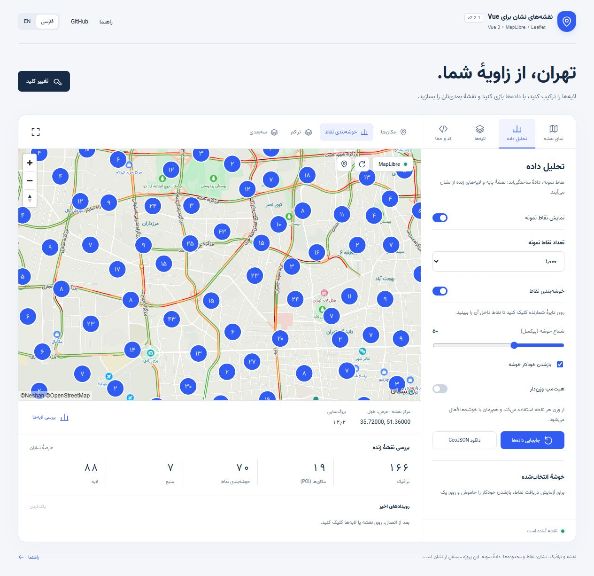
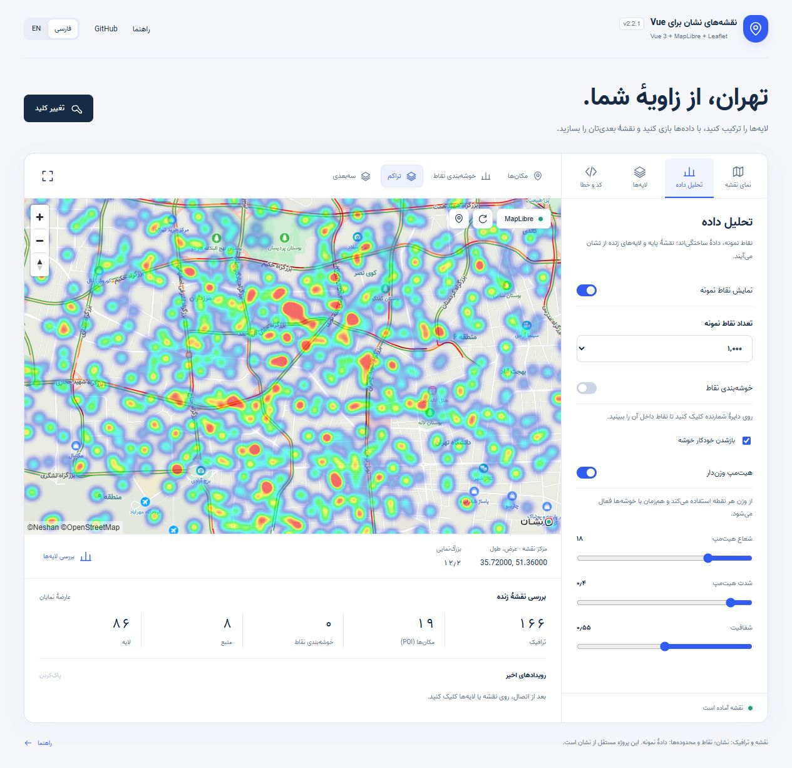
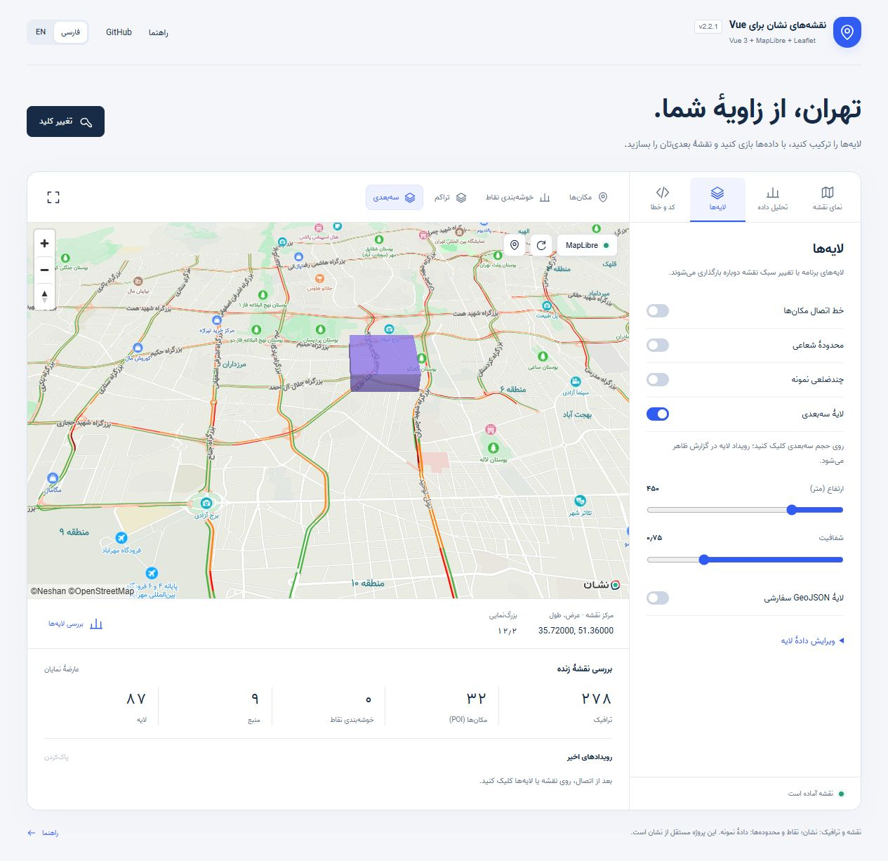

# ‏امکانات پیشرفتهٔ MapLibre

‏[English](ADVANCED.md) · [معرفی](../README.fa.md) · [مرجع API](API.md) · [ناکسـت ۴](NUXT.fa.md)

‏از نسخهٔ `2.2.0`، خوشه‌بندی، هیت‌مپ و منابع و لایه‌های پیشرفته روی همان کامپوننت `NeshanMapLibre` در دسترس‌اند. کامپوننت Leaflet، ماژول و پلاگین Nuxt، مدل‌ها، شکل‌ها، مارکرها و رویدادهای قبلی حفظ شده‌اند.








## ‏نمونهٔ کامل خوشه‌بندی و هیت‌مپ

```vue
<script setup lang="ts">
import { ref } from 'vue'
import { NeshanMapLibre, type Coordinates, type MapResourceFailure } from 'vuejs-neshan-map-leaflet'
import 'vuejs-neshan-map-leaflet/style.css'
import 'vuejs-neshan-map-leaflet/fonts/vazir.css'
const webKey = import.meta.env.VITE_NESHAN_WEB_KEY
const center = ref<Coordinates>([35.72, 51.36])
const zoom = ref(12)
const clustered = ref(true), heat = ref(false)
const map = ref<InstanceType<typeof NeshanMapLibre>>()
const failure = ref<MapResourceFailure>()
const data = ref<GeoJSON.FeatureCollection>({
  type: 'FeatureCollection',
  features: Array.from({ length: 1000 }, (_, id) => ({
    type: 'Feature', id, properties: { weight: 1 + id % 5 },
    geometry: { type: 'Point', coordinates: [51.36 + Math.sin(id * 2.4) * 0.05, 35.72 + Math.cos(id * 1.7) * 0.04] },
  })),
})
const clusterOptions = { radius: 55, maxZoom: 14, minPoints: 2, expandOnClick: true }
const heatOptions = { weightProperty: 'weight', radius: 30, intensity: 0.9, opacity: 0.65 }
function replaceData() {
  data.value = { ...data.value, features: data.value.features.slice(0, 500) }
}
</script>
<template>
  <section class="neshan-font-vazir" lang="fa" dir="rtl">
    <label><input v-model="clustered" type="checkbox">خوشه‌بندی</label>
    <label><input v-model="heat" type="checkbox">هیت‌مپ</label>
    <button @click="replaceData">نمایش ۵۰۰ نقطهٔ نمونه</button>
    <p v-if="failure" role="alert">{{ failure.kind }}: {{ failure.message }}</p>
    <NeshanMapLibre ref="map" v-model="center" v-model:zoom="zoom" :api-key="webKey"
      :geojson="data" :cluster="clustered ? clusterOptions : false"
      :heatmap="heat ? heatOptions : false" traffic poi :center-marker="false"
      :styles="{ height: '550px' }" @resource-error="failure = $event" />
  </section>
</template>
```

‏نقاط بالا دادهٔ نمونه‌اند و از نشان دریافت نشده‌اند. مختصات عمومی کامپوننت به ترتیب عرض و طول است؛ داخل GeoJSON ترتیب طول و عرض است.

‏خوشه‌بندی روی نقاط `geojson` انجام می‌شود؛ مارکرهای DOM در آرایهٔ `markers` خوشه‌بندی نمی‌شوند. برای تعداد زیاد مکان‌ها از GeoJSON استفاده کنید. تنظیم قبلی `geojsonOptions.cluster` همچنان کار می‌کند؛ اگر پراپ `cluster` را صریح بدهید، اولویت با آن است.

| ‏گزینهٔ خوشه‌بندی | ‏رفتار و پیش‌فرض |
| --- | --- |
| `radius` | ‏شعاع پیکسلی؛ پیش‌فرض ۵۰ |
| `maxZoom` | ‏آخرین زوم خوشه‌بندی؛ پیش‌فرض ۱۴ |
| `minPoints` | ‏حداقل نقطه برای تشکیل خوشه؛ پیش‌فرض ۲ |
| `expandOnClick` | ‏بزرگ‌نمایی با کلیک؛ پیش‌فرض روشن |
| `color`, `pointColor`, `textColor` | ‏رنگ خوشه، نقطهٔ مستقل و عدد خوشه |

‏رویداد `cluster-click` اطلاعات `{ clusterId, pointCount, coordinates }` را می‌دهد. برای کنترل اختصاصی، `expandOnClick` را خاموش کنید. دو متد زیر Promise برمی‌گردانند:

```ts
const leaves = await map.value!.getClusterLeaves(clusterId, 20, 0)
const expansionZoom = await map.value!.expandCluster(clusterId, [35.72, 51.36])
```

‏شناسهٔ خوشه پس از تغییر داده یا بازسازی استایل ممکن است عوض شود. پیش از پرس‌وجو دربارهٔ خوشهٔ جدید، منتظر آماده‌شدن منبع بمانید. مرکز اختیاری به ترتیب عرض و طول است؛ دادهٔ برگشتی برگ‌ها GeoJSON است.

‏در هیت‌مپ، `weightProperty` نام ویژگی وزن است؛ مقدار ناموجود یا غیرعددی صفر و مقدار منفی به صفر محدود می‌شود. بدون این گزینه، وزن همهٔ نقاط یک است. پیش‌فرض‌ها: شعاع ۲۴ پیکسل، شدت ۱، شفافیت ۰٫۸ و حداکثر زوم ۲۲. هیت‌مپ منبع جدا و بدون خوشه‌بندی دارد تا همراه خوشه‌ها هم تراکم واقعی همهٔ نقاط را نشان دهد. این کار یک نسخهٔ دوم از داده در Worker می‌سازد؛ برای دادهٔ بسیار حجیم فقط نمای موردنیاز را روشن کنید.

‏پراپ `geojsonLayers` ظاهر معمول نقطه، خط و چندضلعی را جایگزین می‌کند؛ لایه‌های خودکار خوشه و هیت‌مپ جدا اضافه می‌شوند.

## ‏منابع و لایه‌های پیشرفته

‏پراپ `sources` از نوع بومی `SourceSpecification` استفاده می‌کند: GeoJSON، برداری، رستر، ارتفاع، تصویر، ویدئو و Canvas. پراپ `layers` تعریف سریال‌شدنی لایه‌های MapLibre را همراه `beforeId` می‌پذیرد. داده، دامنه، مجوز CORS، زوم، قلم نقشه و Sprite باید با نوع لایه سازگار باشند. اضافه‌کردن منبع ارتفاع به‌تنهایی Terrain را فعال نمی‌کند؛ از `map.setTerrain()` بعد از آماده‌شدن نقشه استفاده کنید. لایهٔ WebGL سفارشی با تابع رندر از API بومی اضافه می‌شود.

```vue
<script setup lang="ts">
import { ref } from 'vue'
import { NeshanMapLibre, type MapLibreAdvancedLayer } from 'vuejs-neshan-map-leaflet'
import 'vuejs-neshan-map-leaflet/style.css'
const webKey = import.meta.env.VITE_NESHAN_WEB_KEY
const districts = ref<GeoJSON.FeatureCollection>({
  type: 'FeatureCollection', features: [{ type: 'Feature', properties: { height: 450 },
    geometry: { type: 'Polygon', coordinates: [[[51.365,35.735],[51.38,35.735],[51.38,35.745],[51.365,35.745],[51.365,35.735]]] } }],
})
const layers: MapLibreAdvancedLayer[] = [
  { id: 'district-volume', type: 'fill-extrusion', source: 'districts',
    paint: { 'fill-extrusion-color': '#7c3aed', 'fill-extrusion-height': ['get', 'height'], 'fill-extrusion-opacity': 0.65 } },
  { id: 'district-outline', type: 'line', source: 'districts', beforeId: 'district-volume',
    paint: { 'line-color': '#4c1d95', 'line-width': 2 } },
]
const selected = ref('')
</script>
<template>
  <NeshanMapLibre :api-key="webKey" :model-value="[35.74,51.37]" :zoom="14"
    :options="{ pitch: 45 }" :sources="{ districts: { type: 'geojson', data: districts } }"
    :layers="layers" :styles="{ height: '550px' }" :center-marker="false"
    @layer-click="selected = $event.layerId" />
  <p>لایهٔ انتخاب‌شده: {{ selected }}</p>
</template>
```

‏شناسه‌های منبع و لایه برای هر کامپوننت پیشوند جدا می‌گیرند تا تداخل نکنند. `source` ابتدا با کلیدهای `sources` تطبیق داده می‌شود؛ نام‌های دیگر به منابع بومی استایل پایه اشاره دارند. `beforeId` ابتدا شناسهٔ لایهٔ خودتان و سپس شناسهٔ بومی استایل را پیدا می‌کند؛ ارجاع به لایهٔ بعدی آرایه هم پشتیبانی می‌شود. بدون آن، ترتیب آرایه از پایین به بالاست. هدف ناموجود، درج معمولی را اعمال می‌کند. شناسهٔ خالی یا تکراری مجاز نیست.

‏هنگام حذف منبع، لایه‌های وابسته را هم حذف یا اصلاح کنید؛ نگه‌داشتن ارجاع به منبع حذف‌شده تعریف نامعتبر MapLibre است. رویداد `layer-click` برای هر لایهٔ مدیریت‌شدهٔ انتخاب‌شده، `{ layerId, features, coordinates }` می‌دهد. شناسهٔ اصلی شما برگردانده می‌شود؛ مختصات عرض‌اول و دادهٔ عارضه بومی است. شناسهٔ داخل شیء بومی عارضه پیشوند دارد. لایه‌هایی که مستقیم با API بومی اضافه کنید مسئولیت برنامه‌اند و باید بعد از `style.load` خودتان بازگردانید.

## ‏سرعت و چرخهٔ عمر

- ‏تغییر هندسه از `GeoJSONSource.setData()` استفاده می‌کند و منبع و لایهٔ بدون تغییر را بازسازی نمی‌کند.
- ‏تغییر تنظیم خوشه‌بندی، منبع و لایه‌های وابسته را بازسازی می‌کند؛ تغییر ظاهر، فیلتر یا چیدمان فقط لایهٔ مربوط را عوض می‌کند.
- ‏رنگ، ضخامت و شفافیت خطوط ویژگی هر عارضه‌اند. خطوط با الگوی خط‌چین یکسان لایهٔ مشترک دارند؛ صد خط مشابه، صد لایه نمی‌سازد.
- ‏تغییرهای هندسه در یک Microtask برای هر گروه جمع می‌شوند. خروج کامپوننت کار معوق، درخواست، تایمر و شنونده‌ها را پاک می‌کند.
- ‏تعویض استایل، خوشه، هیت‌مپ و لایه‌های مدیریت‌شده را بازمی‌گرداند؛ مارکر DOM و پاپ‌آپ باز حفظ می‌شوند.
- ‏تابع `setData()` همچنان ایندکس Worker را به‌روز می‌کند و به معنی تغییر جزئی یک عارضه نیست. برای دادهٔ بزرگ از `shallowRef` و جایگزینی دسته‌ای استفاده کنید. متد بومی `updateData()` برای منابعی که خودتان مدیریت می‌کنید قابل استفاده است.

‏متد `getDiagnostics()` علاوه بر اطلاعات قبلی، `clusterFeatures`، `heatmap`، `advancedLayers`، `sourceCount` و `layerCount` می‌دهد. تعداد عارضهٔ رندرشده به محدوده و زوم وابسته است. پرچم هیت‌مپ فقط تنظیم درخواست‌شده را نشان می‌دهد؛ به‌تنهایی اثبات دریافت داده نیست.

## ‏خطای کلید، دامنه و سهمیه

‏رویداد `resource-error` شیء `MapResourceFailure` می‌دهد: نوع `kind`، پیام امن `message`، کدهای عددی اختیاری `status` و `code`، زمان انتظار `retryAfter` برحسب ثانیه و پیشنهاد `retryable`. رویداد `error` برای راه‌اندازی و رویدادهای قبلی `warning` و `tile-error` برای خطاهای جزئی حفظ شده‌اند.

| ‏کد نشان یا HTTP | `kind` | ‏اقدام |
| --- | --- | --- |
| 480 / 401 | `invalid-key` | ‏کلید وب را بررسی کنید |
| 483 | `key-type` | ‏نوع کلید با سرویس سازگار نیست |
| 484 | `domain` | ‏دامنهٔ مجاز کلید را اصلاح کنید |
| 485 | `service` | ‏دسترسی همان سرویس نقشه، ترافیک یا POI را فعال کنید |
| 481 | `quota` | ‏مصرف و سهمیهٔ حساب را بررسی کنید؛ تکرار خودکار مشکل را حل نمی‌کند |
| 482 / 429 | `rate-limit` | ‏با فاصله تلاش کنید و زمان `retryAfter` را رعایت کنید |
| 403 بدون کد نشان | `forbidden` | ‏دسترسی رد شده؛ پاسخ علت دقیق‌تری مشخص نکرده است |
| 470 / 400 | `request` | ‏پارامتر درخواست نامعتبر است |
| 5xx | `server` | ‏بعداً با تلاش محدود امتحان کنید |
| ‏خطای اتصال | `network` | ‏شبکه یا CORS را بررسی کنید؛ مرورگر همیشه این دو را جدا نمی‌کند |
| ‏رمزگشایی ناموفق | `decode` | ‏سازگاری داده و Codec را بررسی کنید |
| ‏خطای دیگر موتور | `unknown` | ‏در محیط توسعه اطلاعات بومی مطمئن را بررسی کنید |

‏کد پاسخ نشان بر وضعیت عمومی HTTP اولویت دارد. جزئیات عددی و زمان انتظار هنگام انتقال خطا از Worker حفظ می‌شوند. بدنهٔ خام پاسخ، نشانی درخواست و کلید در رویدادهای عمومی منتشر نمی‌شوند. تلاش خودکار بی‌پایان وجود ندارد؛ `retry()` نقشه را با درخواست صریح شما دوباره می‌سازد. شمارنده‌های خطا با تلاش مجدد یا تغییر استایل/لایهٔ زنده پاک می‌شوند.

## ‏امنیت و سازگاری موتور

‏در `2.2.0` موتور آسیب‌پذیر بسته‌بندی‌شده در SDK نشان حذف و `MapLibre GL JS 6.14.0` جایگزین شده است؛ اصلاح [هشدار امنیتی](https://github.com/advisories/GHSA-jrc7-96c5-q579) از `6.4.1` در بالادست وجود دارد. اتصال و Codec نشان، افزونهٔ راست‌به‌چپ و انتساب در یک فورک محدود به آداپتر با مجوز ISC حفظ شده‌اند. این نسخهٔ سازگارشده را جامعه نگه‌داری می‌کند و SDK رسمیِ بدون تغییر نیست. مجوزهای اصلی در `licenses` قرار دارند.

‏موتور و Worker مستقل به‌صورت تنبل در خروجی‌های ESM و CommonJS بارگیری می‌شوند؛ مسیر ثابت `/assets` یا Worker خارجی از CDN لازم نیست. در CSP، مقدار `worker-src blob:` لازم است. افزونهٔ راست‌به‌چپ هم Blob استفاده می‌کند. دامنه‌های کاشی، استایل، قلم و Sprite نشان باید در سیاست‌های مناسب شبکه و تصویر مجاز باشند. تنظیمات Leaflet در صورت استفاده از آن حفظ شوند. نوع‌ها و رفتار بومی MapLibre 6 اعمال می‌شوند؛ کد اختصاصی متکی به API حذف‌شدهٔ نسخهٔ ۵ را طبق [راهنمای مهاجرت بالادست](https://maplibre.org/maplibre-gl-js/docs/guides/v5-to-v6-migration-guide/) اصلاح کنید.

‏پاک‌سازی انتساب و پاپ‌آپ متنی حفظ شده است. منابع و TileJSON مطمئن انتخاب کنید و HTML یا DOM اختصاصی خود را پاک‌سازی کنید. خروجی پاک audit وضعیت وابستگی‌ها در زمان بررسی است و تضمین امنیت همهٔ برنامه نیست. محدودیت یک کلید وب در هر صفحه برای پروتکل نشان همچنان برقرار است.

‏دامنهٔ بررسی امنیت: وابستگی‌های پکیج اصلی و برنامهٔ Vue جدا که فایل بسته‌بندی‌شده را نصب کرد، در این انتشار صفر آسیب‌پذیری گزارش کردند. مثال اختیاری Nuxt نسخهٔ `4.6.1` هشدارهای مستقل بالادست در ابزارها و وابستگی‌های چارچوب، از جمله Devtools و Nitro، دارد. پاس‌شدن ساخت و SSR به معنی پاک‌بودن کل درخت وابستگی Nuxt نیست؛ فایل قفل برنامهٔ خودتان را هم بررسی کنید.

## ‏استفاده در Nuxt 4

‏همهٔ پراپ‌ها، رویدادها و متدهای بالا از طریق ماژول و پلاگین فعلی کار می‌کنند. [راهنمای Nuxt](NUXT.fa.md) را اجرا کنید؛ به‌جای متغیر Vite از `useRuntimeConfig().public.neshanWebKey` استفاده کنید و نقشه را در `<ClientOnly>` قرار دهید. شیء بومی نقشه یا DOM را روی سرور نسازید.

## ‏تست و بررسی

‏دمو هزار نقطهٔ نمونه، کلیدهای خوشه‌بندی و هیت‌مپ و سه‌بعدی، جایگزینی داده و گزارش قابل‌مشاهده دارد. تست‌های نقشهٔ واقعی شامل نمایش، کلیک، ترافیک و مکان‌ها، تغییر داده و بازگردانی بعد از تغییر استایل‌اند. خطاهای سهمیه و سرویس با پاسخ کنترل‌شده تست می‌شوند؛ سهمیهٔ واقعی حساب عمداً تمام نمی‌شود.

```sh
npm test
npm run test:sdk
npm run test:package
npm run test:nuxt
npm run build:demo
npm audit --registry=https://registry.npmjs.org
```

‏برای جلوگیری از تکرار بی‌دلیل ایندکس‌سازی، دادهٔ GeoJSON در هر دستهٔ تغییر با عکس فوری JSON قبلی مقایسه می‌شود. این مقایسه هزینهٔ متناسب با حجم داده دارد؛ دادهٔ یکسان دوباره به Worker ارسال نمی‌شود.
