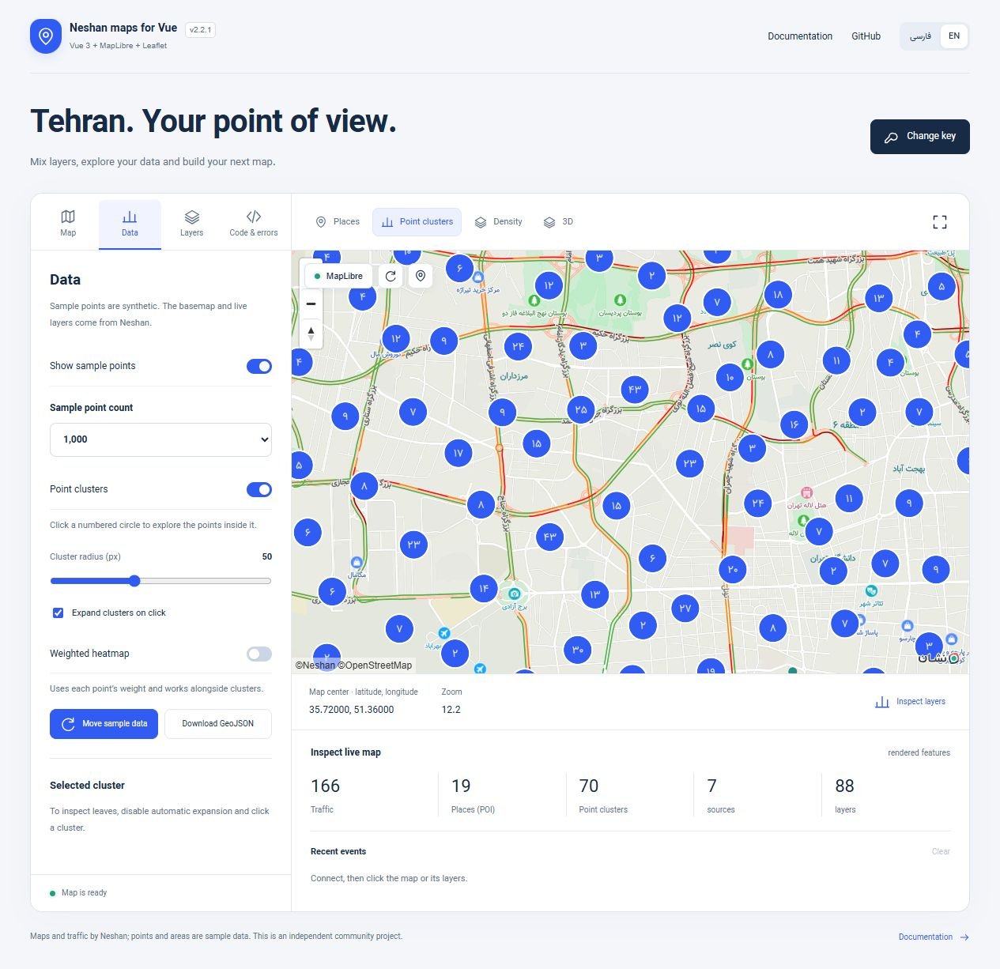
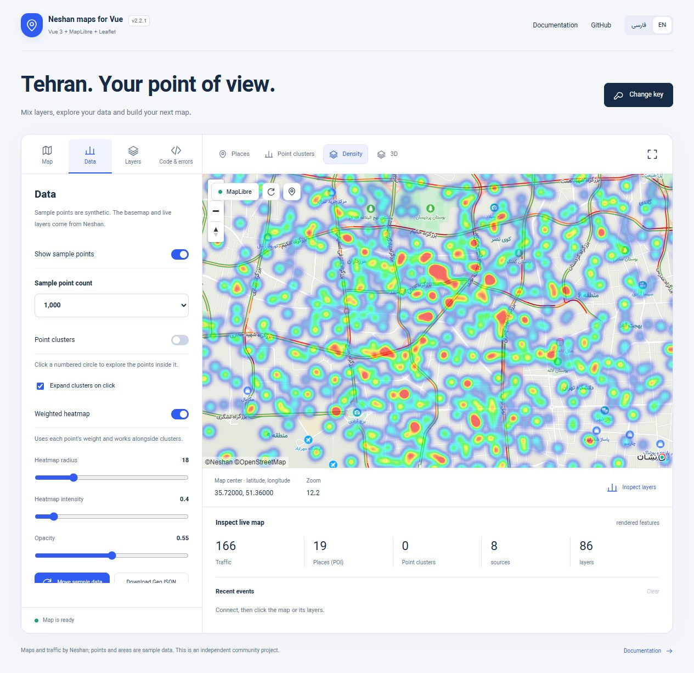
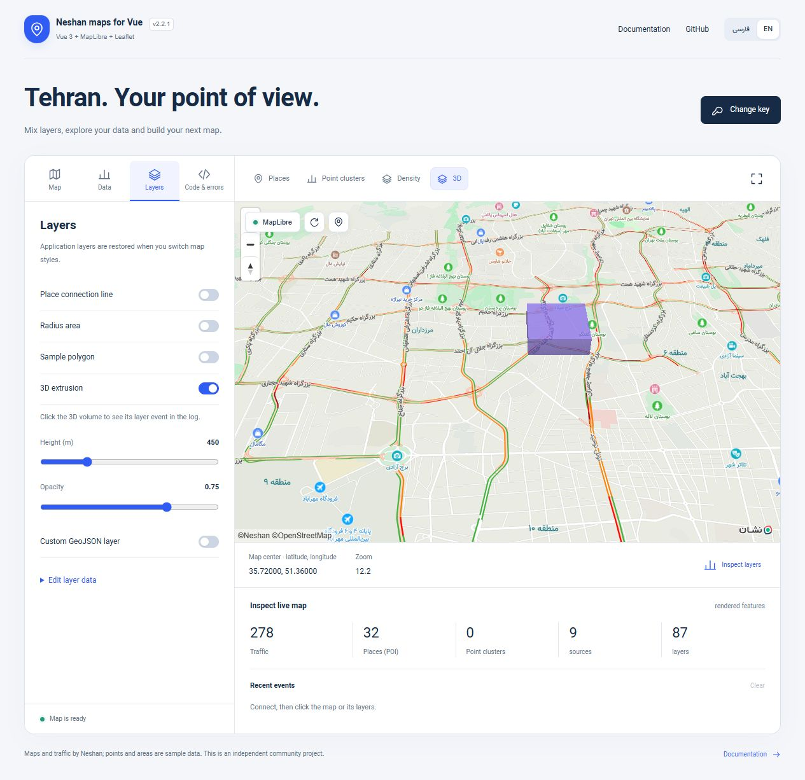

# Advanced MapLibre

[فارسی](ADVANCED.fa.md) · [Overview](../README.md) · [API](API.md) · [Nuxt 4](NUXT.md)

Available in **2.2.0**. These features use the same `NeshanMapLibre` component, web key and Neshan base map. Leaflet, Nuxt module/plugin, existing overlays, models, popups and events remain available.








## Complete example: clusters and heatmap

```vue
<script setup lang="ts">
import { ref } from 'vue'
import { NeshanMapLibre, type Coordinates, type MapResourceFailure } from 'vuejs-neshan-map-leaflet'
import 'vuejs-neshan-map-leaflet/style.css'

const webKey = import.meta.env.VITE_NESHAN_WEB_KEY
const center = ref<Coordinates>([35.72, 51.36])
const zoom = ref(12)
const clustered = ref(true), heat = ref(false)
const map = ref<InstanceType<typeof NeshanMapLibre>>()
const failure = ref<MapResourceFailure>()
const data = ref<GeoJSON.FeatureCollection>({
  type: 'FeatureCollection',
  features: Array.from({ length: 1000 }, (_, id) => ({
    type: 'Feature', id, properties: { weight: 1 + id % 5 },
    geometry: { type: 'Point', coordinates: [51.36 + Math.sin(id * 2.4) * 0.05, 35.72 + Math.cos(id * 1.7) * 0.04] },
  })),
})
const clusterOptions = { radius: 55, maxZoom: 14, minPoints: 2, expandOnClick: true }
const heatOptions = { weightProperty: 'weight', radius: 30, intensity: 0.9, opacity: 0.65 }
function replaceData() {
  data.value = { ...data.value, features: data.value.features.slice(0, 500) }
}
</script>
<template>
  <label><input v-model="clustered" type="checkbox">Clusters</label>
  <label><input v-model="heat" type="checkbox">Heatmap</label>
  <button @click="replaceData">Keep 500 sample points</button>
  <p v-if="failure" role="alert">{{ failure.kind }}: {{ failure.message }}</p>
  <NeshanMapLibre ref="map" v-model="center" v-model:zoom="zoom" :api-key="webKey"
    :geojson="data" :cluster="clustered ? clusterOptions : false"
    :heatmap="heat ? heatOptions : false" traffic poi :center-marker="false"
    :styles="{ height: '550px' }" @resource-error="failure = $event" />
</template>
```

The generated coordinates are sample data, not locations returned by Neshan. Vue public coordinates are `[latitude, longitude]`; GeoJSON coordinates are `[longitude, latitude]`.

Clustering affects points in `geojson`, **not DOM markers** in `markers`. To cluster many places, represent them as GeoJSON points. `geojsonOptions.cluster` still works; an explicitly supplied `cluster` prop takes precedence. A radius is in screen pixels. `maxZoom` is the last zoom at which clustering occurs. `minPoints` defaults to 2. Colors can be configured through `color`, `pointColor`, `textColor`.

Clicking a cluster emits `cluster-click` with `{ clusterId, pointCount, coordinates }` and expands it by default. Set `expandOnClick: false` for your own interaction. Methods return promises:

```ts
const leaves = await map.value!.getClusterLeaves(clusterId, 20, 0)
const expansionZoom = await map.value!.expandCluster(clusterId, [35.72, 51.36])
```

Cluster IDs belong to the current worker data and may change after replacing data or rebuilding a style. Wait for the source to finish loading before querying a newly created cluster. The optional center is latitude first. Leaves use GeoJSON coordinates and properties.

Heatmap weights read `weightProperty`; missing or nonnumeric values become 0, negative values are clamped to 0. Without that option all points have weight 1. Defaults: radius 24px, intensity 1, opacity 0.8, maxZoom 22. A heatmap uses a separate **unclustered** source so it can be displayed together with clusters. It adds a second worker copy of the data; for very large datasets enable only the visualization you need. `geojsonLayers` replaces the ordinary point/line/fill styles; generated heatmap and cluster layers are added separately.

## Advanced sources and layers

`sources` accepts native `SourceSpecification` values: GeoJSON, vector, raster, raster-dem, image, video and canvas. `layers` accepts native serializable `LayerSpecification` values plus `beforeId`. Native features still require valid data, URLs, zoom ranges, glyphs, sprites and server CORS. Adding a terrain source alone does not enable terrain; call `map.setTerrain()` through `ready` when needed. Custom WebGL layer objects with render callbacks use the native map API.

```vue
<script setup lang="ts">
import { ref } from 'vue'
import { NeshanMapLibre, type MapLibreAdvancedLayer } from 'vuejs-neshan-map-leaflet'
import 'vuejs-neshan-map-leaflet/style.css'
const webKey = import.meta.env.VITE_NESHAN_WEB_KEY
const districts = ref<GeoJSON.FeatureCollection>({
  type: 'FeatureCollection', features: [{ type: 'Feature', properties: { height: 450 },
    geometry: { type: 'Polygon', coordinates: [[[51.365,35.735],[51.38,35.735],[51.38,35.745],[51.365,35.745],[51.365,35.735]]] } }],
})
const layers: MapLibreAdvancedLayer[] = [
  { id: 'district-volume', type: 'fill-extrusion', source: 'districts',
    paint: { 'fill-extrusion-color': '#7c3aed', 'fill-extrusion-height': ['get', 'height'], 'fill-extrusion-opacity': 0.65 } },
  { id: 'district-outline', type: 'line', source: 'districts', beforeId: 'district-volume',
    paint: { 'line-color': '#4c1d95', 'line-width': 2 } },
]
const selected = ref('')
</script>
<template>
  <NeshanMapLibre :api-key="webKey" :model-value="[35.74,51.37]" :zoom="14"
    :options="{ pitch: 45 }" :sources="{ districts: { type: 'geojson', data: districts } }"
    :layers="layers" :styles="{ height: '550px' }" :center-marker="false"
    @layer-click="selected = $event.layerId" />
  <p>Selected layer: {{ selected }}</p>
</template>
```

Source and layer IDs are automatically scoped per component. Layer `source` references resolve to your `sources` keys; other names refer to the base style's native sources. `beforeId` resolves to your own layer IDs first, then native base-style IDs. Forward references are supported. Without `beforeId`, array order is bottom to top. A missing target falls back to normal insertion. Never use duplicate or empty IDs. Removing a source also requires removing or changing its dependent layer definitions. Removing it while retaining an old source reference is an invalid native style operation.

`layer-click` reports `{ layerId, features, coordinates }` for each matching managed advanced layer. `layerId` is your original ID, coordinates are latitude first, features retain native/GeoJSON data. The feature's native layer ID is scoped. Layers added directly through the native map are application-owned and need their own restoration after `style.load`.

## Updates, lifecycle and performance

- Geometry updates call `GeoJSONSource.setData()` in place. Unchanged source configuration and layer definitions keep their native identity.
- Cluster source configuration changes rebuild that source and its dependent layers. Changing paint/filter/layout definitions rebuilds affected managed layers.
- Polyline color, width and opacity use per-feature expressions. Lines with the same normalized dash pattern share a layer; 100 equally dashed lines do not create 100 layers.
- Geometry watchers batch changes into one microtask per overlay kind. Unmount cancels pending work, requests, timers and event listeners.
- Style switching restores managed sources, clusters, heatmap and advanced layers; existing DOM markers and open popups are retained.
- Native `setData()` still rebuilds worker indexes; this is not a partial feature-diff API. For large arrays use `shallowRef`, replace data in batches and avoid continually rewriting unchanged data. Native `updateData()` is available through the map ref for application-owned sources.

`getDiagnostics()` additionally reports `clusterFeatures`, `heatmap`, `advancedLayers` (scoped IDs), `sourceCount` and `layerCount`. Rendered counts depend on the viewport and zoom and are not dataset totals. `heatmap` indicates the requested setting, not successful rendering by itself.

## Key, permission and quota errors

Subscribe to `resource-error`; initialization still emits `error`, and partial failures retain `warning` / `tile-error`. The structured payload is `MapResourceFailure`: `kind`, safe `message`, optional numeric `status`, `code`, `retryAfter` (seconds), and `retryable`.

| Neshan code / HTTP status | `kind` | Action |
| --- | --- | --- |
| 480 / 401 | `invalid-key` | Check the web key |
| 483 | `key-type` | Use a key matching this web service |
| 484 | `domain` | Check allowed origins/domains in the Neshan panel |
| 485 | `service` | Enable the required map/traffic/POI permission |
| 481 | `quota` | Check account usage and quota; automatic retry cannot fix exhausted quota |
| 482 / 429 | `rate-limit` | Back off; honor `retryAfter` when provided |
| 403 without a provider code | `forbidden` | Access was denied; the response does not identify the exact cause |
| 470 / 400 | `request` | Check tile/request parameters |
| 5xx | `server` | Retry later with bounded backoff |
| Connection failure | `network` | Check connectivity / CORS; browser failures cannot reliably distinguish them |
| Vector decode failure | `decode` | Check data/codec compatibility |
| Other renderer error | `unknown` | Inspect trusted native diagnostics in development |

Provider response codes take precedence over generic HTTP status. Worker serialization preserves numeric details and Retry-After. Raw response bodies and request URLs/keys are not emitted. `retryable` is advice; the wrapper does not automatically loop or deliberately consume quota. `retry()` explicitly recreates the map. Tile counters reset on retry or style/live-layer changes.

## Security and renderer compatibility

2.2.0 removes the vulnerable renderer bundled inside Neshan SDK 5.24.4. It uses **MapLibre GL JS 6.14.0**, beyond the 6.4.1 fix for [GHSA-jrc7-96c5-q579](https://github.com/advisories/GHSA-jrc7-96c5-q579). The Neshan codec/protocol, RTL plugin and branding are retained in an **adapter-only ISC fork**; this is a community-maintained adaptation, not an unmodified official SDK. Original notices are included under `licenses`.

The renderer and self-contained worker load lazily and are bundled in both ESM and CommonJS artifacts. No runtime CDN worker or application `/assets` path is required. CSP must permit `worker-src blob:`; Neshan tile/style/glyph/sprite hosts require the appropriate `connect-src` / `img-src`. The bundled RTL plugin also uses a blob URL. Keep existing Leaflet CSP rules when using that engine. Native MapLibre 6 behavior/types apply to the exposed map; custom integrations using removed MapLibre 5 APIs need updating. See the [upstream migration guide](https://maplibre.org/maplibre-gl-js/docs/guides/v5-to-v6-migration-guide/).

Style/control attribution sanitization and text-only popups remain in place. Use trusted source/TileJSON hosts and sanitize your custom HTML/DOM. A clean dependency audit is a snapshot, not a guarantee against every application security issue. The retained Neshan protocol permits one web key per page; concurrent maps must use the same key.

Audit scope: the root package and the separate plain Vue installed-tarball consumer reported zero vulnerabilities for this release. The optional Nuxt 4.6.1 example retains two independent, unpatched upstream advisories in its Nitro dependency chain; its successful build/SSR checks do not mean its whole dependency tree has a clean audit. Recheck your own application's lockfile when adopting Nuxt.

## Nuxt 4

All these props/events/methods work through the existing module or plugin. Follow [Nuxt setup](NUXT.md), use `useRuntimeConfig().public.neshanWebKey` instead of the Vite environment value, and put the map inside `<ClientOnly>`. Keep GeoJSON/source/layer declarations in the client component; do not create native map/DOM instances on the server.

## Verification

Run `npm test`, `npm run test:sdk`, `npm run test:package`, `npm run test:nuxt`, `npm run build:demo`, and `npm audit --registry=https://registry.npmjs.org`. The playground includes 1,000 deterministic sample points, cluster/heatmap/3D toggles, data replacement and visible diagnostics. Real-map checks validate rendering, clicks, traffic/POI, data updates and style restoration. Quota/error branches are verified with controlled HTTP fixtures; tests do not intentionally exhaust an account's quota.

GeoJSON is compared against its previous JSON snapshot once per update batch, preventing repeated worker indexing for equal inline props while still detecting in-place edits. Comparison costs scale with data size; batch large updates instead of continuously rewriting identical arrays.

In 2.2.3 the Nuxt example Git-tooling critical advisories are fixed with a scoped override; two unpatched upstream high advisories remain. [Exact audit scope, consumer configuration and limitations](DEPENDENCY-SECURITY.md).
