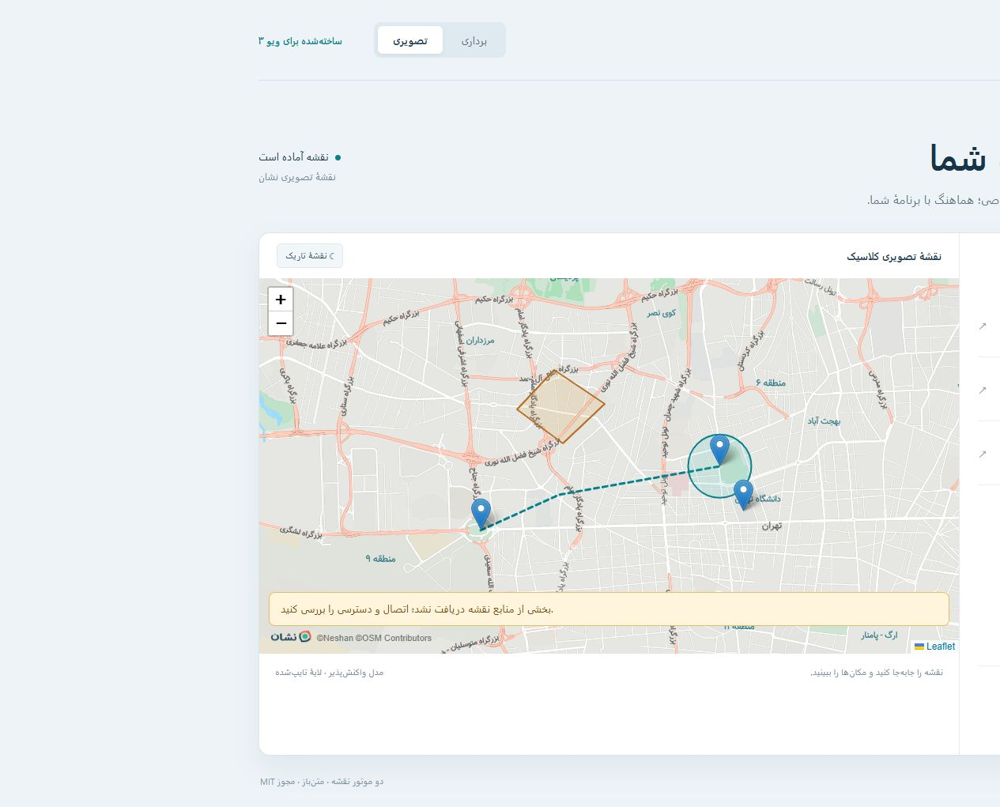

# ‏آموزش امکانات

‏[معرفی و نصب](../README.fa.md) · [English](GUIDE.md) · [مرجع API](API.md) · [مثال‌های بیشتر](EXAMPLES.md)

‏[آموزش کامل ماژول و پلاگین Nuxt 4](NUXT.fa.md)
‏ابتدا نصب و ساخت کلید وب مجاز برای دامنه را مطابق README انجام دهید. این راهنما بر پایهٔ Composition API است. کدهای دارای `<script setup>` کامل را می‌توانید در یک فایل `.vue` قرار دهید؛ قطعه‌کدهای کوتاه، تکمیل‌کنندهٔ همان نمونه‌اند.

‏[نمونهٔ کامل](#complete-map) · [انتخاب نقطه](#picking) · [مارکرها](#markers) · [لایه‌های زنده](#live-layers) · [شکل‌ها](#shapes) · [GeoJSON](#geojson) · [کنترل‌ها](#controls) · [وضعیت](#status) · [یکپارچه‌سازی](#integration) · [Leaflet](#leaflet) · [استفادهٔ عملی](#production)

<a id="complete-map"></a>
## ‏نمونهٔ کامل

‏نمونهٔ زیر امکانات اصلی را کنار هم دارد: ترافیک و مکان‌ها، مارکر قابل جابه‌جایی، محدودهٔ خدمات، تغییر سبک، انتخاب نقطه و کنترل‌های برنامه. بسته، پنل یا نوار کناری آماده به برنامه تزریق نمی‌کند؛ رابط را مطابق نیازتان طراحی کنید.

‏کلید `VITE_NESHAN_WEB_KEY` را در `.env.local` بگذارید. پس از تغییر متغیر محیطی، Vite را دوباره اجرا کنید. متن دکمه‌های این نمونه را می‌توانید فارسی کنید.

```vue
<script setup lang="ts">
import { ref } from 'vue'
import {
  NeshanMapLibre, MAPLIBRE_STYLES,
  type Coordinates, type MapLibreMarker, type MapCircle,
  type MapPolygon, type MapPolyline, type TileState,
} from 'vuejs-neshan-map-leaflet'
import 'vuejs-neshan-map-leaflet/style.css'

const webKey = import.meta.env.VITE_NESHAN_WEB_KEY
const center = ref<Coordinates>([35.6997, 51.338])
const zoom = ref(13)
const traffic = ref(true)
const poi = ref(true)
const dark = ref(false)
const picking = ref(false)
const mapRef = ref<InstanceType<typeof NeshanMapLibre>>()
const initialized = ref(false)
const resourceStatus = ref('idle')
const message = ref('')
const markers = ref<MapLibreMarker[]>([
  { id: 'azadi', position: [35.6997, 51.338], popup: 'Azadi Square',
    tooltip: 'Drag to edit', options: { color: '#087f8c', draggable: true } },
  { id: 'laleh', position: [35.711, 51.39], popup: 'Laleh Park' },
])
const circles: MapCircle[] = [
  { id: 'service', center: [35.711, 51.39], radius: 620,
    options: { color: '#087f8c', fillColor: '#1eb5aa', fillOpacity: 0.15 } },
]
const polygons: MapPolygon[] = [
  { id: 'area', positions: [[35.721, 51.346], [35.728, 51.354], [35.722, 51.365]],
    options: { color: '#b66a20', fillColor: '#e3ad58', fillOpacity: 0.2 } },
]
const polylines: MapPolyline[] = [
  { id: 'connection', positions: [[35.6997, 51.338], [35.711, 51.39]],
    options: { color: '#087f8c', weight: 3, dashArray: '6,5' } },
]
function saveMarker(marker: MapLibreMarker, position: Coordinates) {
  markers.value = markers.value.map(item => item.id === marker.id ? { ...item, position } : item)
}
function resources(state: TileState) { resourceStatus.value = state.status }
function showError(error: Error) { message.value = error.message }
function locationError(error: { code: number; message: string }) { message.value = error.message }
function locate() { mapRef.value?.locate({ setView: true, maxZoom: 16 }) }
function inspect() {
  const report = mapRef.value?.getDiagnostics()
  message.value = report
    ? `${report.markers} markers; ${report.trafficFeatures} traffic features; ${report.poiFeatures} POI features in this view`
    : 'Map is not ready yet'
}
</script>

<template>
  <section aria-label="Map controls">
    <label><input v-model="traffic" type="checkbox">Traffic</label>
    <label><input v-model="poi" type="checkbox">Places</label>
    <label><input v-model="dark" type="checkbox">Dark style</label>
    <label><input v-model="picking" type="checkbox">Pick a point</label>
    <button :disabled="!initialized" @click="mapRef?.fitToMarkers()">Show all places</button>
    <button :disabled="!initialized" @click="mapRef?.flyTo([35.711, 51.39], 15)">Laleh Park</button>
    <button :disabled="!initialized" @click="mapRef?.openPopup('azadi')">Open Azadi</button>
    <button :disabled="!initialized" @click="locate">My location</button>
    <button :disabled="!initialized" @click="inspect">Inspect layers</button>
  </section>
  <NeshanMapLibre
    ref="mapRef" v-model="center" v-model:zoom="zoom" :api-key="webKey"
    :map-style="dark ? MAPLIBRE_STYLES.dark : MAPLIBRE_STYLES.light"
    :traffic="traffic" :poi="poi" :pick-on-click="picking"
    :center-marker="picking" :markers="markers"
    :circles="circles" :polygons="polygons" :polylines="polylines"
    :styles="{ height: '520px' }" aria-label="Tehran places and service area"
    @ready="initialized = true" @destroy="initialized = false"
    @marker-dragend="saveMarker" @tiles-loading="resources"
    @tiles-loaded="resources" @tile-error="resources"
    @warning="message = $event" @error="showError"
    @location-error="locationError"
  >
    <template #loading><p role="status">Preparing the map…</p></template>
    <template #error="{ error, retry }">
      <p role="alert">{{ error.message }} <button @click="retry">Try again</button></p>
    </template>
    <template #tile-error="{ state }">
      <p role="status">Some resources failed ({{ state.failed }}). Check the key and network.</p>
    </template>
  </NeshanMapLibre>
  <p>Selected center: {{ center[0].toFixed(5) }}, {{ center[1].toFixed(5) }} · Zoom: {{ zoom }}</p>
  <p role="status">Map resources: {{ resourceStatus }}. {{ message }}</p>
</template>
```

<a id="picking"></a>
## ‏انتخاب نقطه

‏مقدار `v-model` مرکز نقشه و ترتیب آن `[latitude, longitude]` است. جابه‌جایی نقشه این مقدار را حتی با انتخاب خاموش تغییر می‌دهد. گزینهٔ `pickOnClick` مرکز را به محل کلیک می‌برد و `centerMarker` سنجاق ثابت مرکز را نشان می‌دهد. این تنظیمات آدرس را ذخیره نمی‌کنند و مارکری به آرایه اضافه نمی‌کنند.

‏برای انتخاب آدرس سفارش، مقدار تأییدشده را جدا نگه دارید. دکمهٔ تأیید، یک کپی از مرکز را در فرم ذخیره کند. اگر فقط نقطهٔ کلیک را می‌خواهید، `coordinates` در رویداد `click` را بخوانید. مختصات کلیک در هر دو کامپوننت با عرض جغرافیایی شروع می‌شود.

```ts
const confirmedLocation = ref<Coordinates>()
function confirmLocation() { confirmedLocation.value = [...center.value] }
```

‏تبدیل مختصات به آدرس نیازمند اتصال جداگانه به سرویس ژئوکد معکوس در سمت سرور است. این بسته نقشه و مختصات را نمایش می‌دهد.

<a id="markers"></a>
## ‏مارکرها

‏برای هر مارکر `id` یکتا و ثابت تعیین کنید. تغییر `position` آن را جابه‌جا و حذف از آرایه آن را حذف می‌کند. مقدار `popup` متن ساده است؛ `tooltip` در MapLibre به عنوان DOM تبدیل می‌شود. کلیک رویداد `marker-click` و پایان کشیدن رویداد `marker-dragend(marker, coordinates)` ایجاد می‌کند.

‏تابع `saveMarker` در نمونه، نتیجهٔ کشیدن را در وضعیت برنامه ذخیره می‌کند؛ بدون این کار، رندر بعدی می‌تواند مارکر را به موقعیت کنترل‌شدهٔ قبلی برگرداند. برای MapLibre از `MapLibreMarker` و برای Leaflet از `MapMarker` استفاده کنید؛ تنظیمات بومی آن‌ها یکسان نیست.

```ts
markers.value = [...markers.value, {
  id: 'new-place', position: [...center.value], popup: 'New place',
}]
markers.value = markers.value.filter(marker => marker.id !== 'new-place')
```

‏برای ظاهر کاملاً سفارشی، MapLibre یک `HTMLElement` در ویژگی `element` می‌پذیرد. ساخت و پاک‌سازی این DOM بر عهدهٔ شماست؛ HTML نامطمئن وارد نکنید. مارکر پیش‌فرض به DOM سفارشی نیاز ندارد. متد `openPopup(id)` پاپ‌آپ مارکر موجود را باز می‌کند.

<a id="live-layers"></a>
## ‏ترافیک، مکان‌ها و سبک

‏مقادیر `traffic` و `poi` را مطابق نمونه به متغیرهای بولی متصل کنید. پیش‌فرض هر دو خاموش است. سبک‌های استاندارد نشان منابع لازم را دارند. ثابت `MAPLIBRE_STYLES` پنج گزینهٔ `light`، `dark`، `monochrome_light`، `monochrome_dark` و `pastel` ارائه می‌کند.

‏تغییر `mapStyle` نمونهٔ نقشه، مارکرهای DOM و پاپ‌آپ را حفظ می‌کند؛ پس از بارگیری سبک، لایه‌های مدیریت‌شده و وضعیت نمایش دوباره اعمال می‌شوند. سبک سفارشی نسخهٔ ۸ یا URL باید منابع و لایه‌های سازگار `traffic` و `points_source` نشان را داشته باشد. رویداد `warning` نبود گروه‌ها و `live-layers` شناسهٔ لایه‌های پیدا‌شده را گزارش می‌دهد.

‏وقتی ترافیک روشن است، کاشی‌های آن هر ۶۰ ثانیه دوباره درخواست می‌شوند. تازگی، کش، سهمیه و دسترسی را نشان تعیین می‌کند. مکان‌ها در زوم پایین ممکن است دیده نشوند. خروجی `getDiagnostics()` عوارض رندرشدهٔ نمای فعلی را می‌شمارد؛ روشن‌بودن کلید به تنهایی به معنای بارگیری داده نیست.

<a id="shapes"></a>
## ‏خط، چندضلعی و دایره

‏آرایه‌ها را به `polylines`، `polygons` و `circles` بدهید. همهٔ موقعیت‌ها با عرض جغرافیایی شروع می‌شوند و `radius` دایره بر حسب **متر** است. تغییر داده، شکل را بازترسیم می‌کند. برای حفرهٔ چندضلعی، آرایهٔ حلقه‌ها را بدهید. این شکل‌ها مستقل از `geojson` هستند و هم‌زمان قابل استفاده‌اند.

| شکل | تنظیمات پشتیبانی‌شده در MapLibre |
| --- | --- |
| ‏خط | `color`, `weight`, `opacity`, `dashArray` |
| ‏چندضلعی و دایره | `color`, `weight`, `fill`, `fillColor`, `fillOpacity` |

‏در Leaflet تنظیمات بومی شکل پذیرفته می‌شوند. MapLibre فقط زیرمجموعهٔ بالا را ترجمه می‌کند؛ callback و افزونه‌های Leaflet منتقل نمی‌شوند. دایره در موتور برداری، تقریب چندضلعی ژئودزیک است. خط‌چین نمونه، هندسهٔ داده‌شدهٔ برنامه است و مسیر محاسبه‌شدهٔ نشان نیست.

<a id="geojson"></a>
## ‏دادهٔ GeoJSON

‏ترتیب GeoJSON همیشه **طول و سپس عرض جغرافیایی** است؛ حتی در کامپوننت Leaflet. آرایهٔ اختیاری `geojsonLayers` سبک بومی MapLibre را کنترل می‌کند. ویژگی `source` را ندهید؛ کامپوننت آن را مدیریت می‌کند. بدون لایهٔ سفارشی، سبک پیش‌فرض نقطه، خط و چندضلعی استفاده می‌شود.

```ts
import type { MapLibreOverlayLayer } from 'vuejs-neshan-map-leaflet'

const geojson = {
  type: 'FeatureCollection' as const,
  features: [{
    type: 'Feature' as const,
    properties: { name: 'Azadi Square' },
    geometry: { type: 'Point' as const, coordinates: [51.338, 35.6997] },
  }],
}
const geojsonLayers: MapLibreOverlayLayer[] = [{
  id: 'places', type: 'circle',
  paint: { 'circle-radius': 8, 'circle-color': '#087f8c',
    'circle-stroke-color': '#ffffff', 'circle-stroke-width': 2 },
}]
```

```vue
<NeshanMapLibre :api-key="webKey" :geojson="geojson" :geojson-layers="geojsonLayers" />
```

‏مقدار `geojsonOptions` در MapLibre تنظیمات منبع بومی GeoJSON و در Leaflet تنظیمات `L.GeoJSONOptions` است. [نمونهٔ کامل GeoJSON](EXAMPLES.md#geojson-and-custom-maplibre-paint) را برای شروع قابل اجرا ببینید.

<a id="controls"></a>
## ‏کنترل نقشه از برنامه

‏از ref کامپوننت مطابق نمونهٔ کامل استفاده کنید. دکمه‌ها را تا رویداد `ready` غیرفعال نگه دارید و در `destroy` وضعیت آمادگی را پاک کنید.

| هدف | روش |
| --- | --- |
| ‏نمایش همهٔ مارکرها | `fitToMarkers()` یا prop واکنش‌پذیر `fitMarkers` |
| ‏حرکت به نقطه | `flyTo([latitude, longitude], zoom)` |
| ‏نمایش محدوده | `fitBounds(bounds, options)` با ترتیب مختصات بومی موتور |
| ‏اصلاح اندازه پس از بازشدن پنل پنهان | `invalidateSize()`؛ تغییر اندازهٔ معمول خودکار است |
| ‏راه‌اندازی مجدد | `retry()` با خروجی Promise |
| ‏درخواست موقعیت دستگاه | `locate({ setView: true, maxZoom: 16 })` |

‏موقعیت را پس از اقدام مشخص کاربر درخواست کنید. HTTPS یا localhost و اجازهٔ مرورگر لازم است. رویدادهای `location-found` و `location-error` را مدیریت کنید؛ همهٔ دستگاه‌ها قادر به ارسال موقعیت نیستند. رویداد `ready` موفقیت راه‌اندازی است و موفقیت مجوز همهٔ کاشی‌ها را تضمین نمی‌کند.

<a id="status"></a>
## ‏بارگیری و مدیریت خطا

‏در نمونه سه slot جدا استفاده شده است: `loading` برای راه‌اندازی، `error` برای شکست راه‌اندازی همراه تلاش مجدد و `tile-error` برای شکست بخشی از منابع. خطای جزئی می‌تواند هم‌زمان با یک نقشهٔ قابل استفاده رخ دهد.

‏رویدادهای `tiles-loading`، `tiles-loaded` و `tile-error` را جدا از `ready` بخوانید. مقدار `TileState` شامل `status`، `loaded` و `failed` است. MapLibre اعلان‌های آمادگی منبع و Leaflet نتیجهٔ کاشی‌های تصویری را می‌شمارد؛ این شمارنده‌ها قابل مقایسه نیستند. در MapLibre، راه‌اندازی مجدد یا تغییر سبک و لایه‌های زنده شمارندهٔ خطا را بازنشانی می‌کند.

‏با `ariaLabel` کاربرد نقشه را توصیف کنید. دکمه‌های برنامه برچسب خوانا، فوکوس کیبورد و خروجی متنی مختصات و وضعیت داشته باشند. پیام‌ها را با slot سفارشی کنید.

<a id="integration"></a>
## ‏یکپارچه‌سازی

### ‏دسترسی به موتور بومی

‏برای نگه‌داشتن ref بومی، `useNeshanMapLibre` را استفاده و **هر دو** handler چرخهٔ عمر را متصل کنید. کامپوننت نقشه را آزاد می‌کند و composable ارجاع خود را پاک می‌کند. API بومی MapLibre بر خلاف متد عمومی `flyTo` کامپوننت، طول جغرافیایی را اول می‌گیرد.

```vue
<script setup lang="ts">
import { NeshanMapLibre, useNeshanMapLibre } from 'vuejs-neshan-map-leaflet'
import 'vuejs-neshan-map-leaflet/style.css'
const webKey = import.meta.env.VITE_NESHAN_WEB_KEY
const { map, onReady, onDestroy } = useNeshanMapLibre()
function go() {
  // Native MapLibre coordinates are LONGITUDE first.
  map.value?.flyTo({ center: [51.338, 35.6997], zoom: 15 })
}
</script>
<template>
  <button :disabled="!map" @click="go">Azadi Square</button>
  <NeshanMapLibre :api-key="webKey" @ready="onReady" @destroy="onDestroy" />
</template>
```

‏برای Leaflet از `useNeshanMap` استفاده کنید؛ مقدار `ready` برابر `{ map, L }` است. در MapLibre این مقدار `{ map, maplibre }` است. API و افزونهٔ بومی دو موتور یکسان نیستند. برای تغییر `options` مخصوص سازنده، با `:key` کامپوننت را دوباره mount کنید.

### ‏اتصال Nuxt و ثبت سراسری

‏واردکردن بسته در SSR ایمن است و موتور پس از mount راه‌اندازی می‌شود. CSS را سراسری در تنظیمات Nuxt وارد کنید؛ اگر اتصال اطراف نقشه نیاز دارد، از فایل `.client.vue` یا `<ClientOnly>` استفاده کنید. کلید وب را از تنظیمات عمومی و کلید سرویس را فقط از تنظیمات خصوصی سرور بخوانید.

```ts
export default defineNuxtConfig({
  css: ['vuejs-neshan-map-leaflet/style.css'],
  runtimeConfig: { public: { neshanWebKey: '' } },
})
```

‏متغیر `NUXT_PUBLIC_NESHAN_WEB_KEY` را در محیط استقرار تنظیم کنید. [مثال Nuxt و افزونه](EXAMPLES.md#nuxt) کد کامل اتصال را دارد. واردکردن محلی ساده است؛ در صورت نیاز `app.use(NeshanMapPlugin)` هر دو کامپوننت را سراسری ثبت می‌کند.

### ‏مهاجرت از نسخهٔ ۱

‏نسخهٔ ۲ برای Vue 3.5.43 به بعد است و واردکردن CSS ضروری است. Vue وابستگی peer است. اسکریپت UMD قدیمی را با import بسته جایگزین کنید. در Leaflet ویژگی‌های `options.key`، `options.center` و رویدادهای `latitude` و `longitude` حفظ شده‌اند؛ برای کد جدید `apiKey` و دو مدل را ترجیح دهید. دادهٔ شکل‌ها و مارکرها قابل استفاده است، ولی تنظیمات مارکر بومی هنگام تغییر موتور باید تطبیق یابد. نصب‌های قدیمی خودکار تغییر نمی‌کنند.

<a id="leaflet"></a>
## ‏استفاده از Leaflet

‏برای اتصال‌های موجود Leaflet از `NeshanMapLeaflet` استفاده کنید. مدل مختصات و شکل‌ها الگوی یکسانی دارند؛ تنظیمات بومی و سبک GeoJSON به موتور وابسته‌اند.

```vue
<script setup lang="ts">
import { ref } from 'vue'
import { NeshanMapLeaflet, type Coordinates, type MapMarker } from 'vuejs-neshan-map-leaflet'
import 'vuejs-neshan-map-leaflet/style.css'
const webKey = import.meta.env.VITE_NESHAN_WEB_KEY
const center = ref<Coordinates>([35.6997, 51.338])
const zoom = ref(13)
const markers: MapMarker[] = [{ id: 'azadi', position: [35.6997, 51.338], popup: 'Azadi Square' }]
</script>
<template>
  <NeshanMapLeaflet v-model="center" v-model:zoom="zoom" :api-key="webKey"
    :options="{ maptype: 'dreamy' }" :markers="markers" :center-marker="false"
    :styles="{ height: '500px' }" />
</template>
```



‏SDK قدیمی نشان، ترافیک و مکان‌ها را به‌روز نمی‌کند. این گزینه‌ها با هشدار نادیده گرفته می‌شوند؛ برای لایهٔ زنده MapLibre را انتخاب کنید. بعضی درخواست‌های تکمیلی برچسب تصویری ممکن است پاسخ ۲۰۴ بدون تصویر بدهند. برای تشخیص تحویل جزئی، رویداد کاشی را بخوانید.

<a id="production"></a>
## ‏استفاده در محصول

‏دامنه‌های مجاز کلید وب را محدود کنید و انتساب نشان و OpenStreetMap را حفظ کنید. CSS را یک بار وارد و ارتفاع غیرصفر تعیین کنید. پشتیبانی WebGL و `DecompressionStream` را برای MapLibre بررسی کنید. نقشه‌های MapLibre هم‌زمان باید کلید یکسان داشته باشند؛ پروتکل رسمی وضعیت سراسری صفحه دارد.

‏جست‌وجو، ژئوکد، مسیریابی، رابط اندازه‌گیری و ذخیرهٔ داده متعلق به برنامه‌اند. صفحهٔ نمونه بعضی تعامل‌ها را نشان می‌دهد؛ بسته، مجموعهٔ ویجت‌های آن صفحه را صادر نمی‌کند. خط، مختصات داده‌شده را نمایش می‌دهد و مسیر را محاسبه نمی‌کند.

‏SDK رسمی هشدار امنیتی وابستگی مستند دارد؛ پیش از افزودن استایل، انتساب یا DOM نامطمئن، [محدودیت امنیتی](API.md#slots) را بخوانید. پاپ‌آپ متنی و پاک‌سازی انتساب به معنی اصلاح موتور رسمی نیست. تنظیمات CSP، میزبانی SDK و پیش‌فرض دقیق در [مرجع API](API.md) آمده است.

‏برای اشکال، جدول عیب‌یابی README را بررسی و نسخهٔ بسته، موتور و مرورگر و نمونهٔ کوچک بازتولید را ارسال کنید. کلید و اطلاعات ورود را از گزارش حذف کنید.
