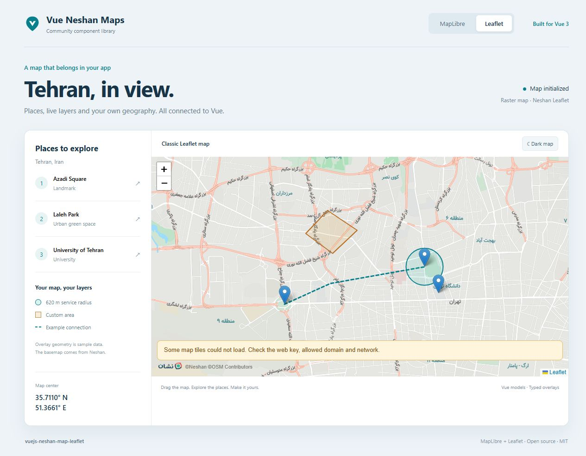

# Feature guide

[Overview](../README.md) · [فارسی](GUIDE.fa.md) · [API reference](API.md) · [More complete examples](EXAMPLES.md)

Start with the README's installation instructions and a domain-allowed Neshan **web** key. This guide builds on Vue's Composition API. Code fences containing a complete `<script setup>` component can be copied into a `.vue` file; shorter snippets extend that component.

## Contents

[Complete map](#complete-map) · [Picking](#picking) · [Markers](#markers) · [Live layers](#live-layers) · [Shapes](#shapes) · [GeoJSON](#geojson) · [Controls](#controls) · [Status](#status) · [Integration](#integration) · [Leaflet](#leaflet) · [Production](#production)

## Complete map

The example below combines the main capabilities in one component: live layers, editable places, a service area, a style switch, a point picker and application-owned controls. No control panel or sidebar is injected by the package. Build the interface that fits your app.

Set `VITE_NESHAN_WEB_KEY` in `.env.local` and restart Vite after changing environment variables.

```vue
<script setup lang="ts">
import { ref } from 'vue'
import {
  NeshanMapLibre, MAPLIBRE_STYLES,
  type Coordinates, type MapLibreMarker, type MapCircle,
  type MapPolygon, type MapPolyline, type TileState,
} from 'vuejs-neshan-map-leaflet'
import 'vuejs-neshan-map-leaflet/style.css'

const webKey = import.meta.env.VITE_NESHAN_WEB_KEY
const center = ref<Coordinates>([35.6997, 51.338])
const zoom = ref(13)
const traffic = ref(true)
const poi = ref(true)
const dark = ref(false)
const picking = ref(false)
const mapRef = ref<InstanceType<typeof NeshanMapLibre>>()
const initialized = ref(false)
const resourceStatus = ref('idle')
const message = ref('')
const markers = ref<MapLibreMarker[]>([
  { id: 'azadi', position: [35.6997, 51.338], popup: 'Azadi Square',
    tooltip: 'Drag to edit', options: { color: '#087f8c', draggable: true } },
  { id: 'laleh', position: [35.711, 51.39], popup: 'Laleh Park' },
])
const circles: MapCircle[] = [
  { id: 'service', center: [35.711, 51.39], radius: 620,
    options: { color: '#087f8c', fillColor: '#1eb5aa', fillOpacity: 0.15 } },
]
const polygons: MapPolygon[] = [
  { id: 'area', positions: [[35.721, 51.346], [35.728, 51.354], [35.722, 51.365]],
    options: { color: '#b66a20', fillColor: '#e3ad58', fillOpacity: 0.2 } },
]
const polylines: MapPolyline[] = [
  { id: 'connection', positions: [[35.6997, 51.338], [35.711, 51.39]],
    options: { color: '#087f8c', weight: 3, dashArray: '6,5' } },
]
function saveMarker(marker: MapLibreMarker, position: Coordinates) {
  markers.value = markers.value.map(item => item.id === marker.id ? { ...item, position } : item)
}
function resources(state: TileState) { resourceStatus.value = state.status }
function showError(error: Error) { message.value = error.message }
function locationError(error: { code: number; message: string }) { message.value = error.message }
function locate() { mapRef.value?.locate({ setView: true, maxZoom: 16 }) }
function inspect() {
  const report = mapRef.value?.getDiagnostics()
  message.value = report
    ? `${report.markers} markers; ${report.trafficFeatures} traffic features; ${report.poiFeatures} POI features in this view`
    : 'Map is not ready yet'
}
</script>

<template>
  <section aria-label="Map controls">
    <label><input v-model="traffic" type="checkbox">Traffic</label>
    <label><input v-model="poi" type="checkbox">Places</label>
    <label><input v-model="dark" type="checkbox">Dark style</label>
    <label><input v-model="picking" type="checkbox">Pick a point</label>
    <button :disabled="!initialized" @click="mapRef?.fitToMarkers()">Show all places</button>
    <button :disabled="!initialized" @click="mapRef?.flyTo([35.711, 51.39], 15)">Laleh Park</button>
    <button :disabled="!initialized" @click="mapRef?.openPopup('azadi')">Open Azadi</button>
    <button :disabled="!initialized" @click="locate">My location</button>
    <button :disabled="!initialized" @click="inspect">Inspect layers</button>
  </section>
  <NeshanMapLibre
    ref="mapRef" v-model="center" v-model:zoom="zoom" :api-key="webKey"
    :map-style="dark ? MAPLIBRE_STYLES.dark : MAPLIBRE_STYLES.light"
    :traffic="traffic" :poi="poi" :pick-on-click="picking"
    :center-marker="picking" :markers="markers"
    :circles="circles" :polygons="polygons" :polylines="polylines"
    :styles="{ height: '520px' }" aria-label="Tehran places and service area"
    @ready="initialized = true" @destroy="initialized = false"
    @marker-dragend="saveMarker" @tiles-loading="resources"
    @tiles-loaded="resources" @tile-error="resources"
    @warning="message = $event" @error="showError"
    @location-error="locationError"
  >
    <template #loading><p role="status">Preparing the map…</p></template>
    <template #error="{ error, retry }">
      <p role="alert">{{ error.message }} <button @click="retry">Try again</button></p>
    </template>
    <template #tile-error="{ state }">
      <p role="status">Some resources failed ({{ state.failed }}). Check the key and network.</p>
    </template>
  </NeshanMapLibre>
  <p>Selected center: {{ center[0].toFixed(5) }}, {{ center[1].toFixed(5) }} · Zoom: {{ zoom }}</p>
  <p role="status">Map resources: {{ resourceStatus }}. {{ message }}</p>
</template>
```

## Picking

`v-model` is the **map center**, in `[latitude, longitude]` order. Panning updates it even when picking is off. `pickOnClick` moves that center to the clicked position; `centerMarker` displays a fixed pin. These props do not save an address or add a marker to your array.

For a checkout picker, keep a separate confirmed value. A confirm button can copy `center.value` into your form. Use the `click` event's `coordinates` if you only want the clicked point rather than the current center. Both engines expose latitude-first click coordinates.

```ts
const confirmedLocation = ref<Coordinates>()
function confirmLocation() { confirmedLocation.value = [...center.value] }
```

Reverse geocoding is a separate server-side service integration. This library displays maps and coordinates; it does not turn a point into an address.

## Markers

Give every marker a unique, stable `id`. Replace or update its `position` to move it; remove it from the array to remove it from the map. `popup` is plain text, and MapLibre `tooltip` becomes a DOM title. Clicking a marker emits `marker-click`; dragging emits `marker-dragend(marker, coordinates)`.

The complete example's `saveMarker` persists drag results in application state. Without that update, a subsequent render can put the marker back at its old controlled position. Use `MapLibreMarker` for MapLibre and `MapMarker` for Leaflet: their native `options` are different.

```ts
markers.value = [...markers.value, {
  id: 'new-place', position: [...center.value], popup: 'New place',
}]
markers.value = markers.value.filter(marker => marker.id !== 'new-place')
```

MapLibre accepts an `HTMLElement` through `element` for a custom marker. Create and sanitize that DOM yourself; do not pass untrusted HTML. Default markers need no custom DOM. `openPopup(id)` opens the popup of an existing MapLibre marker.

## Live layers

Bind `traffic` and `poi` to booleans, as in the complete example. Both default to `false`. The standard Neshan styles contain the required sources. `MAPLIBRE_STYLES` provides `light`, `dark`, `monochrome_light`, `monochrome_dark` and `pastel`.

Changing `mapStyle` preserves the map instance, DOM markers and popups; managed overlays and live visibility are restored after style loading. A custom version-8 style or URL must contain compatible Neshan `traffic` and `points_source` sources/layers to display live data. Listen to `warning` for missing groups and `live-layers` for matched layer IDs.

Traffic tiles are requested again every 60 seconds while enabled. Data freshness, HTTP caches, availability and quotas are controlled by Neshan. POI may not appear at low zoom. `getDiagnostics()` counts rendered features in the current view; a checked switch alone does not prove that data loaded.

## Shapes

Pass arrays to `polylines`, `polygons` and `circles`. All positions are latitude first, and circle `radius` is in **meters**. Replace the relevant data to redraw a shape. Use polygon ring arrays for holes. Shapes are independent of `geojson`, so they can coexist.

| Shape | MapLibre options supported by the wrapper |
| --- | --- |
| Line | `color`, `weight`, `opacity`, `dashArray` |
| Polygon / circle | `color`, `weight`, `fill`, `fillColor`, `fillOpacity` |

Leaflet accepts its native shape options. MapLibre translates only the documented subset; Leaflet callbacks/plugins do not carry over. MapLibre circles are geodesic polygon approximations. The dashed connection in the example is supplied geometry, not a route computed by Neshan.

## GeoJSON

GeoJSON is **longitude first**, including when used with the Leaflet component. The optional MapLibre `geojsonLayers` array controls native rendering; omit `source` because the component manages it. Without custom layers, the component supplies point/line/polygon styling.

```ts
import type { MapLibreOverlayLayer } from 'vuejs-neshan-map-leaflet'

const geojson = {
  type: 'FeatureCollection' as const,
  features: [{
    type: 'Feature' as const,
    properties: { name: 'Azadi Square' },
    geometry: { type: 'Point' as const, coordinates: [51.338, 35.6997] },
  }],
}
const geojsonLayers: MapLibreOverlayLayer[] = [{
  id: 'places', type: 'circle',
  paint: { 'circle-radius': 8, 'circle-color': '#087f8c',
    'circle-stroke-color': '#ffffff', 'circle-stroke-width': 2 },
}]
```

```vue
<NeshanMapLibre :api-key="webKey" :geojson="geojson" :geojson-layers="geojsonLayers" />
```

`geojsonOptions` contains native GeoJSON source options on MapLibre and `L.GeoJSONOptions` on Leaflet. See the [complete GeoJSON component](EXAMPLES.md#geojson-and-custom-maplibre-paint) for a runnable starting point.

## Controls

Use a component ref, as in the complete example, for the public commands below. Disable controls until `ready` and clear readiness on `destroy`.

| Task | Command / behavior |
| --- | --- |
| Show all markers | `fitToMarkers()` or reactive `fitMarkers` |
| Move to a place | `flyTo([latitude, longitude], zoom)` |
| Frame a region | `fitBounds(bounds, options)`; native engine coordinate order |
| Repair size after opening a hidden panel | `invalidateSize()`; normal resizing is automatic |
| Reinitialize | `retry()`; returns a promise |
| Request device location | `locate({ setView: true, maxZoom: 16 })` |

`locate` should run after an explicit user action. It needs HTTPS/localhost and browser permission. Handle `location-found` and `location-error`; do not assume every device can provide a position. `ready` means initialization succeeded, not that every tile has been authorized.

## Status

The complete example uses three different slots: `loading` for initialization, `error` for initialization failure with a retry action, and `tile-error` for partial resource failure. A partial failure can coexist with a usable map.

Track `tiles-loading`, `tiles-loaded` and `tile-error` separately from `ready`. Their `TileState` payload contains `status`, `loaded` and `failed`. MapLibre counts source readiness notifications, while Leaflet counts raster tile results; these counters are not interchangeable. For MapLibre, reinitialization or style/live-layer changes reset failure counters.

Use `ariaLabel` to describe the map's purpose. Give application buttons readable labels, keyboard focus styles and textual coordinate/status feedback. Slots let you adapt messages without replacing the renderer.

## Integration

### Native APIs

Use `useNeshanMapLibre` to retain native refs; wire **both** lifecycle handlers. The component disposes of the map, while the composable clears its references. Native MapLibre calls use longitude first, unlike the component's public `flyTo` method.

```vue
<script setup lang="ts">
import { NeshanMapLibre, useNeshanMapLibre } from 'vuejs-neshan-map-leaflet'
import 'vuejs-neshan-map-leaflet/style.css'
const webKey = import.meta.env.VITE_NESHAN_WEB_KEY
const { map, onReady, onDestroy } = useNeshanMapLibre()
function go() {
  // Native MapLibre coordinates are LONGITUDE first.
  map.value?.flyTo({ center: [51.338, 35.6997], zoom: 15 })
}
</script>
<template>
  <button :disabled="!map" @click="go">Azadi Square</button>
  <NeshanMapLibre :api-key="webKey" @ready="onReady" @destroy="onDestroy" />
</template>
```

For Leaflet, use `useNeshanMap`; `ready` contains `{ map, L }`. MapLibre uses `{ map, maplibre }`. Do not assume native APIs or plugins work across engines. Constructor-only `options` require remounting with a Vue `:key` when they change.

### Nuxt and global registration

Imports are SSR-safe; renderer initialization runs on mount. Import CSS globally in `nuxt.config.ts`; use a `.client.vue` component or optional `<ClientOnly>` when your surrounding integration requires it. Obtain the web key through public runtime config. Keep **service keys** in private server config.

```ts
export default defineNuxtConfig({
  css: ['vuejs-neshan-map-leaflet/style.css'],
  runtimeConfig: { public: { neshanWebKey: '' } },
})
```

Set `NUXT_PUBLIC_NESHAN_WEB_KEY` in your deployment environment. [Nuxt and plugin examples](EXAMPLES.md#nuxt) show the component and registration code. Local imports are simplest; `app.use(NeshanMapPlugin)` registers both components globally when preferred.

### Migrating from 1.x

Version 2 targets Vue 3.5.43+ and requires an explicit CSS import. Vue is a peer dependency. Replace old UMD script usage with package imports. Leaflet `options.key`, `options.center`, `latitude` and `longitude` events remain supported; prefer `apiKey` and the two models for new code. Existing Leaflet markers/shape data remain useful, but native marker options need adaptation when switching engines. Old installations are not changed automatically.

## Leaflet

Use `NeshanMapLeaflet` for existing Leaflet integrations. The coordinate model and declarative shape props follow the same pattern, but native options and GeoJSON styling are engine-specific.

```vue
<script setup lang="ts">
import { ref } from 'vue'
import { NeshanMapLeaflet, type Coordinates, type MapMarker } from 'vuejs-neshan-map-leaflet'
import 'vuejs-neshan-map-leaflet/style.css'
const webKey = import.meta.env.VITE_NESHAN_WEB_KEY
const center = ref<Coordinates>([35.6997, 51.338])
const zoom = ref(13)
const markers: MapMarker[] = [{ id: 'azadi', position: [35.6997, 51.338], popup: 'Azadi Square' }]
</script>
<template>
  <NeshanMapLeaflet v-model="center" v-model:zoom="zoom" :api-key="webKey"
    :options="{ maptype: 'dreamy' }" :markers="markers" :center-marker="false"
    :styles="{ height: '500px' }" />
</template>
```



The official legacy SDK no longer updates traffic and POI. Those options are ignored with a warning; use MapLibre for live layers. Some supplemental raster label requests can return HTTP 204 without an image. Observe tile events when diagnosing partial delivery.

## Production

Restrict web keys to your actual domains and keep attribution visible. Import package CSS once and give the map a nonzero height. Test modern WebGL/`DecompressionStream` support for MapLibre. All concurrent Neshan MapLibre instances must use the same API key because the vendor protocol has page-global state.

Search, geocoding, routing, measurement interfaces and persistence are application concerns. The playground demonstrates some of these interactions; it is not a bundle of UI widgets exported by this package. A polyline displays supplied coordinates and does not calculate a route.

The vendor SDK has a documented dependency advisory; read the [security limitation](API.md#slots) before adding untrusted styles, attribution or DOM. The wrapper's text popups and attribution sanitization do not patch the vendor engine. For CSP/custom SDK hosting and exact defaults, consult the [API reference](API.md).

If something fails, start with the README's [troubleshooting table](../README.md#troubleshooting), then include package/engine/browser versions and a small reproduction in an issue. Remove credentials from reports.
